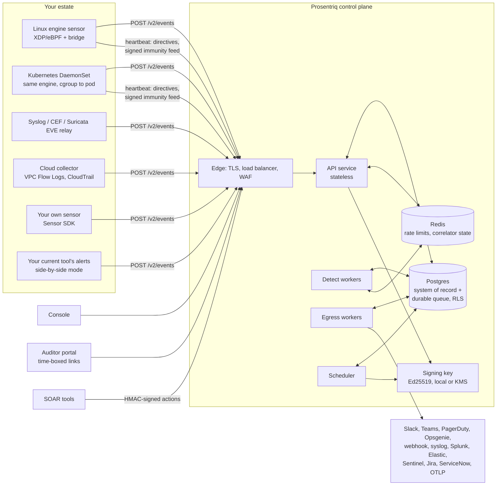
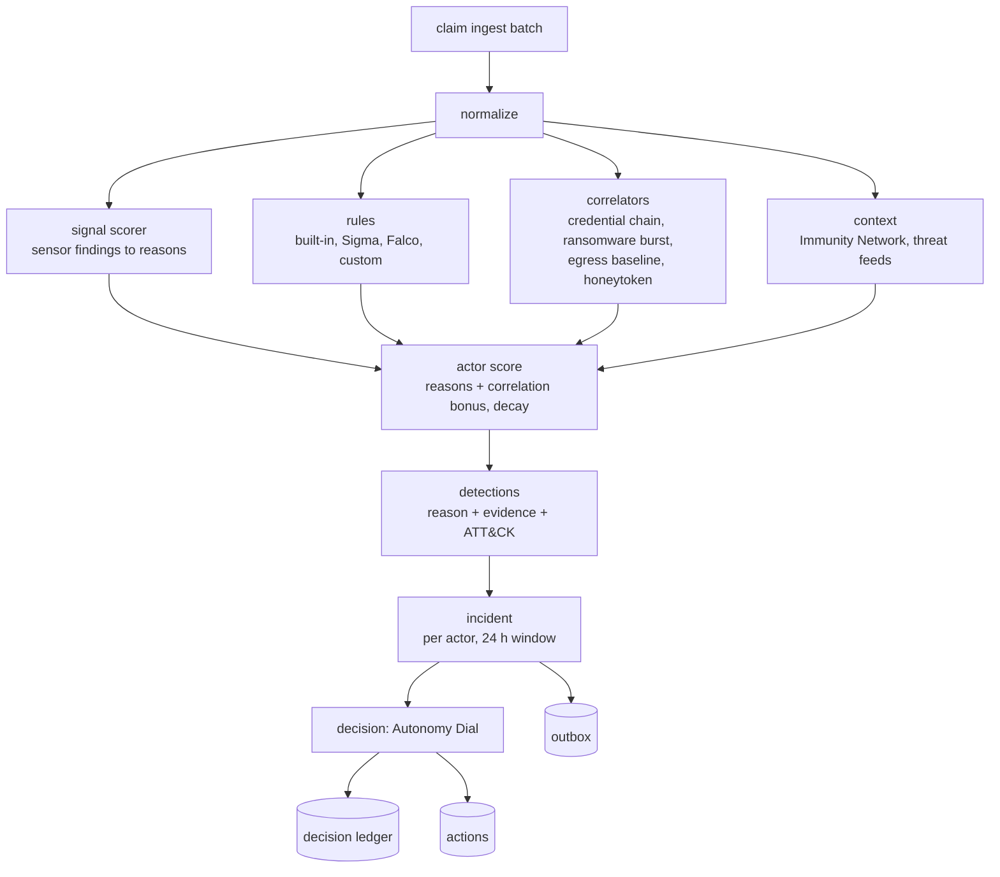

# Architecture

Prosentriq is **one control plane plus thin, replaceable sensors**. The Linux
XDP/eBPF engine is the first and best sensor, not the whole product. Every
sensor (the Linux engine, the Kubernetes DaemonSet, log relays, cloud
collectors and sensors you build with the SDK) speaks one canonical,
OCSF-aligned event schema to one ingest door, `POST /v2/events`.

The control plane scores events, explains them (a reason, the evidence and the
MITRE ATT&CK technique), groups them into incidents and decides what to do.
Every decision passes through the **Autonomy Dial and five safety mechanisms**
before anything is enforced, and every decision is recorded in a
counterfactual ledger whether or not it was enforced. That ledger is at once
the explanation, the compliance evidence, the Trial Value Report and the
false-positive metric.

## Design principles

| | Principle |
|---|---|
| 1 | **No unauthenticated state-changing endpoint anywhere**, in the cloud or on a host |
| 2 | **Safe by construction before enforcement.** Observe is the default; enforcement is earned per organization and per host |
| 3 | **Every decision is explainable and recorded**, enforced or not. Every block carries its reasons |
| 4 | **The brain is central, the sensors are thin.** Sensors normalize and report; scoring, correlation and decisions are central. Sensors still enforce locally and fail open |
| 5 | **Tenant isolation is enforced by the database** (Postgres row-level security), not only by query discipline |
| 6 | **Few moving parts, every one replaceable.** Postgres is the system of record and the durable queue at launch scale; interfaces exist to swap in Kafka or ClickHouse without touching business logic |
| 7 | **Never ship what you don't have.** Docs, pricing and marketing are generated from, or tested against, the code |
| 8 | **Self-hostable with no open-core catch.** The same artifacts run hosted, self-hosted and air-gapped |

## System context

## Sensors

| Sensor | What it is |
|---|---|
| **Linux engine** | An XDP firewall, an observe-only probe that can only pass packets, a process profiler, file integrity monitoring, a honeypot and a local scoring engine, with a local Autonomy Gate and circuit breaker. x86_64 and ARM64 |
| **Sensor bridge** | Enrolls the host, heartbeats, pulls directives and applies them through the engine's authenticated local API, ships findings as events, watches decoy files |
| **Kubernetes** | The engine and bridge as a DaemonSet, with pod, namespace and image attribution |
| **Log relay** | Syslog (RFC 3164/5424), CEF and Suricata EVE JSON to events |
| **Cloud collector** | AWS VPC Flow Logs and CloudTrail to events |
| **Your own** | Anything that uses the [SDK](https://github.com/PROSENTRIQ/prosentriq-sdk-python) or the HTTP API |

Sensors are deliberately simple about policy. They keep a local copy of the
effective autonomy level and the circuit-breaker limits, so **local enforcement
keeps working, and keeps failing safe, when the control plane is unreachable**.
The engine fails open: if it stops, traffic passes.

Windows and macOS sensors (observe-only first) are designed but not built.
They will be new sensors against the same schema, not ports of the engine.

## The control plane

One package, several process types from the same image:

- **API**: stateless, behind a load balancer. It serves the console, sensors,
  integrations and the public endpoints.
- **Detect workers** claim ingest batches from the durable queue and run the
  detection pipeline.
- **Egress workers** deliver notifications to your destinations.
- **Scheduler**: canary progression and rollback, circuit-breaker cool-downs,
  action expiry, Trial Value Reports, the never-block list refresh, the
  immunity feed, partition maintenance, retention and usage metering. Several
  run; one leads at a time.

A small installation runs everything in one container. A large one scales each
part on its own.

### Data stores

| Store | Holds | Why |
|---|---|---|
| **Postgres** | Everything durable: organizations, identity, sensors, events (partitioned by month), detections, incidents, the ledger, actions, rules, the outbox, the audit log and evidence packs. Also the ingest queue | One transactional system of record. Row-level security for isolation. Native `inet`/`cidr` types for blast-radius checks. Partitioning for retention. A `SKIP LOCKED` queue handles thousands of batches a second, transactionally with the event write |
| **Redis** | Rate-limit windows, correlator state (credential chains, ransomware bursts, egress baselines) and short caches | Ephemeral and TTL-native. **Not** on the durable path: if Redis is down, the API and ingest keep working |
| **Signing key** | One Ed25519 key for evidence packs, the immunity feed and federation | A local key, AWS KMS, Google Cloud KMS or HashiCorp Vault. Key changes are linked by endorsements that sensors and peers follow |

## Tenancy, identity and access

- An **organization** is one customer. An MSP organization is the parent of its
  customer organizations; MSP members get their MSP role, capped at admin, in
  every customer.
- **Roles**: owner, admin, analyst, auditor (read-only plus evidence).
- **Credentials** are stored only as hashes. Console sessions use an
  `HttpOnly; Secure; SameSite=Strict` cookie plus a CSRF token. Passwords use
  Argon2id; MFA is TOTP with single-use recovery codes; SSO is OIDC
  (authorization code with PKCE, JWKS-verified ID tokens, nonce, verified
  domains). API keys are scoped (`ingest`, `read`, `write`, `admin`, `soar`) and
  revocable. Each sensor has its own credential, which can only send events,
  heartbeat and read the feed.
- **Account recovery is two-step**: a single-use, expiring link is emailed
  before anything changes, and unknown addresses get the same answer (no
  account enumeration).

### Isolation enforced by Postgres

Every table that belongs to an organization has a `tenant_id` and a forced
row-level security policy. Each request's transaction is limited to exactly the
organizations the caller may see. A query that forgets its `WHERE tenant_id = …`
returns nothing from other organizations instead of leaking. The application
connects as a role that is neither a superuser nor the tables' owner, so
row-level security can't be bypassed by accident.

### Audit log

Every privileged action (sign-in, MFA change, key issued or revoked, autonomy
change, approval, undo, rule rollout, destination change, evidence export,
support access) appends to the audit log with a **per-organization hash chain**:
`hash = SHA256(prev_hash || canonical_json(entry))`. Evidence packs embed the
chain head, so editing history is detectable.

## The event pipeline

### Ingest

`POST /v2/events` accepts batches of up to 1,000 events (5 MB after gzip),
idempotent per `metadata.uid`, so retries are free. The events and one queue
entry are written in the same transaction. Per-credential quotas apply.
[Sending events](../api/events.md) has the details.

### Detection

Every score increment is a reason with a sentence, evidence and ATT&CK
techniques. The scoring constants match the host engine's, so a host and the
cloud agree on what an event is worth. See
[Detections](../concepts/detections.md).

## Autonomy and safety

The Autonomy Dial (levels 1 to 5) decides what may be enforced without a
person. Every proposed action is checked by five mechanisms: the
counterfactual ledger, the blast-radius check, canary rollouts for new rules,
circuit breakers and one-click undo. See [The Autonomy Dial](../concepts/autonomy.md).

Enforced actions reach hosts as directives on their next heartbeat (every 30
seconds), each with a TTL, and are re-sent until the host acknowledges them.

## Integrations

One subsystem, not one per tool: notifications are written to an outbox in the
same transaction as the change they describe, then delivered with retries,
exponential backoff and a dead-letter queue. Webhooks are HMAC-SHA256 signed.
Inbound SOAR actions need a scoped API key and an HMAC signature, and still
pass the blast-radius check. See [Integrations](../guides/integrations.md) and
[SOAR](../guides/soar.md).

## Compliance

Controls in SOC 2, PCI DSS v4.0, HIPAA, ISO 27001:2022, NIST CSF 2.0, NIST
800-53, CIS v8, NIS2 and DORA are mapped to the evidence that substantiates
them. Packs are canonical JSON, Ed25519-signed, optionally RFC 3161
timestamped, and verifiable offline. See [Compliance](../guides/compliance.md).

## Collective Immunity Network

Organizations report attacker addresses only, never traffic. An address is
published when 3 independent organizations report it, with reporter weights,
a TTL on every entry and the never-block list applied last. The feed is
signed, and sensors verify it before use. Self-hosted control planes run
private hubs that can federate with the global network. See
[Immunity Network](../concepts/immunity-network.md).

## Scaling

A busy Linux host sends about 1 to 5 events per second after sensor-side
aggregation: the engine scores locally and forwards findings, not packets.

| Stage | Nodes | Shape |
|---|---|---|
| Launch | 1 – 20,000 | Several API pods, detect and egress workers, a leader-elected scheduler, Postgres with a replica and a connection pooler, Redis. Events partitioned monthly; the queue in Postgres |
| Growth | 20,000 – 200,000 | The queue moves to Kafka or Redpanda and events to ClickHouse, behind the same interfaces, with Postgres keeping a hot window; read replicas for the console |
| Scale | 200,000 and more | **Cells**: identical regional stacks, each serving a slice of organizations, with a thin global layer for identity, billing, routing and the Immunity Network. An organization never spans cells, so any failure is contained to one cell |

What makes each stage a swap instead of a rewrite is enforced today: every row
is keyed by organization, services are stateless, the queue and event store
sit behind interfaces, ingest is idempotent, and the scheduler is a singleton
through a Postgres advisory lock.

## Deployment

- **Hosted**: the service at cockpit.prosentriq.com.
- **Self-hosted** (Enterprise): the same control plane on Kubernetes (Helm) or
  one VM (Docker Compose). No feature is held back.
- **Air-gapped** (Enterprise): self-hosted, plus a local signing key, a private
  Immunity hub, an offline package repository, and the AI assistant disabled.
- **Sensors**: signed `.deb` and `.rpm` packages for x86_64 and ARM64, signed
  apt and dnf repositories, the Helm chart, and `install.sh`, a thin bootstrapper
  that configures the signed repository and enrolls the host.

See [Self-hosting](../self-hosting/README.md).
