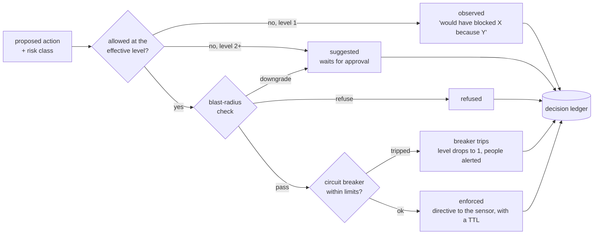

# The Autonomy Dial and its safety mechanisms

Prosentriq can block attackers on its own, but only as far as you allow, and
only after five safety mechanisms agree. Every decision is recorded whether or
not it was enforced, so you can see what autonomy would have done before you
turn it on.

## The dial

| Level | Name | Enforced automatically |
|---|---|---|
| 1 | Observe | Nothing. Decisions are recorded as "would have blocked X because Y" |
| 2 | Suggest | Nothing. Every proposed action waits in **Approvals & actions** for a person |
| 3 | Enforce low-risk | Known-bad sources only: threat-feed hits, Immunity Network indicators, honeypot and honeytoken hits |
| 4 | Enforce high-confidence | Level 3, plus critical actors backed by two or more independent kinds of evidence |
| 5 | Full autonomy | Level 4, plus other behavioural blocks, host isolation and freezing a ransomware process |

Set the level on the **Autonomy dial** page (owners and admins), or with
`PUT /v2/autonomy`. Every change needs a reason and is written to the audit log.

### The effective level

The level that actually applies to a host can be lower than the one you set.
It is the lowest of:

- the organization's level
- the host's own cap (Sensors → the host, `autonomy_override`)
- your plan's highest level: 1 on Free, 3 on Starter, 5 on Pro and Enterprise
- what the sensor can do: a host still running the observe-only probe never enforces

While a circuit breaker is tripped, the effective level is 1. The Autonomy
page says which of these is holding the level down. A host must also be in
*enforce* mode (Sensors) for blocks to apply on it.

## The decision path

Every action Prosentriq proposes, for example "block 203.0.113.9 for 24 hours",
goes through the same steps:

Automatic blocks expire: 1 hour for a medium-severity actor, 24 hours for high
and 7 days for critical. Manual blocks take the TTL you give (60 seconds to 90
days).

## The five safety mechanisms

### 1. Counterfactual ledger

Every decision, whatever its outcome (observed, suggested, refused, enforced),
is stored with the full list of reasons and the result of every safety check.
Read it on **Decision ledger** or with `GET /v2/decisions`. It is your
explanation, your compliance evidence and your false-positive record in one.

### 2. Blast-radius check

Before any block, Prosentriq tests what the block could break.

It **refuses** to block:

- anything on your allowlist (**Autonomy dial → Allowlist**)
- the never-block list: major public DNS resolvers, the published address
  ranges of AWS, Google Cloud, Cloudflare and Fastly (refreshed daily), cloud
  instance metadata addresses, and the Prosentriq control plane itself
- the sensor's own address or its gateway
- a range wider than a /24 (IPv4) or a /48 (IPv6)

It **downgrades to a suggestion** (a person must approve):

- private and internal ranges
- established legitimate peers: addresses your sensors have exchanged traffic
  with across at least 3 days and 24 active hours, with no prior detections

Ask the check directly with `POST /v2/blast-radius/check`.

### 3. Canary rollouts for new rules

A new rule (imported from Sigma or Falco, custom, or machine-generated) never
goes straight to the whole fleet:

| Stage | Where it runs |
|---|---|
| 1 | One host, observe-only |
| 2 | About 10% of hosts, enforcing |
| 3 | Every host, enforcing |

Each stage lasts a dwell time (1 hour by default). The rollout advances only if
no undo or false positive is attributed to the rule, no circuit breaker is
open, and the rule's match rate is normal. Otherwise it rolls back on its own
and reverts every action the rule caused. An active rule with 3 undos within
24 hours is rolled back too. See [Rules](../guides/rules.md).

### 4. Circuit breaker

The breaker watches, per organization and per sensor, how many blocks happen
and how many get undone:

| Limit | Default |
|---|---|
| Blocks per minute, organization | 20 |
| Blocks per minute, one sensor | 10 |
| Undos per hour | 3 |
| Cool-down before a reset is allowed | 30 minutes |

When a limit is crossed the breaker trips. The effective level drops to 1
(Observe), your integrations are alerted (`breaker.tripped`), and an owner or
admin must reset it after the cool-down (**Autonomy dial → Reset breaker**). Change the
limits on the same page or with `PUT /v2/autonomy/breaker-limits`.

Each sensor carries the same breaker locally, with its own limits from the
control plane, so it stays safe while it's offline.

### 5. One-click undo

Every enforced action has **Undo** (`POST /v2/actions/{id}/undo`). Undo sends
the reverse directive (unblock, release, thaw, or roll back the rule), is
audited, and counts as a false-positive signal. That signal feeds the circuit
breaker, the rule's rollout, and the reporter's weight in the Immunity Network.

## Approvals

At level 2, and whenever the blast-radius check downgrades an action, the
action waits in **Approvals & actions**. Anyone with the triage permission
(owner, admin, analyst) can approve or reject it. Approved actions still go
through the circuit breaker.

## Fail-safe on the host

The Linux engine fails open: if it crashes or the agent stops, traffic passes.
`sudo prosentriq-ctl kill-switch` detaches every XDP program at once. See
[On the host](../guides/host.md).
